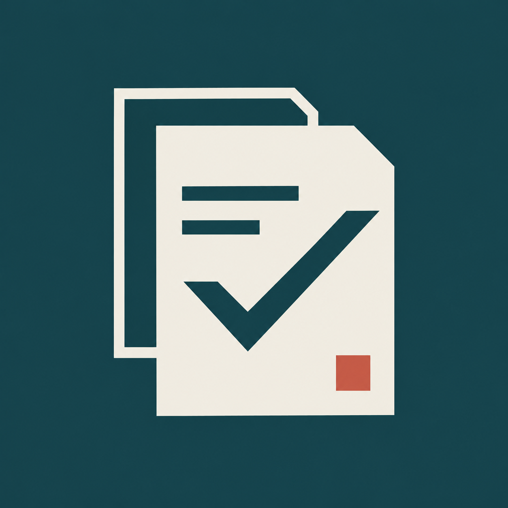
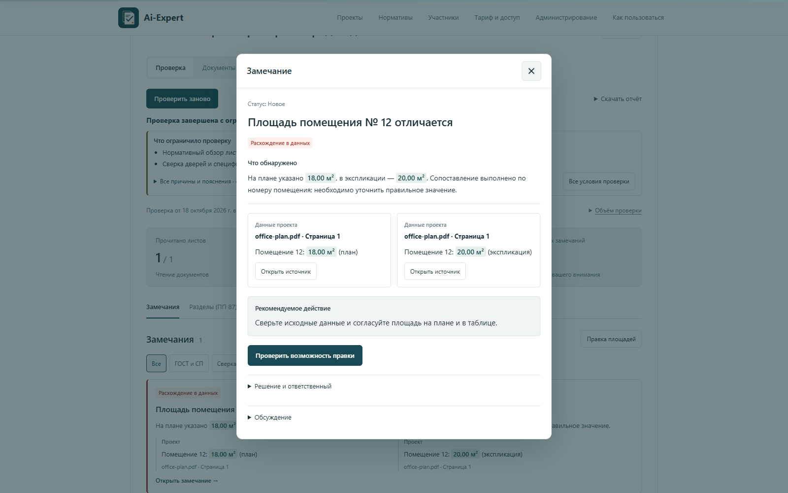
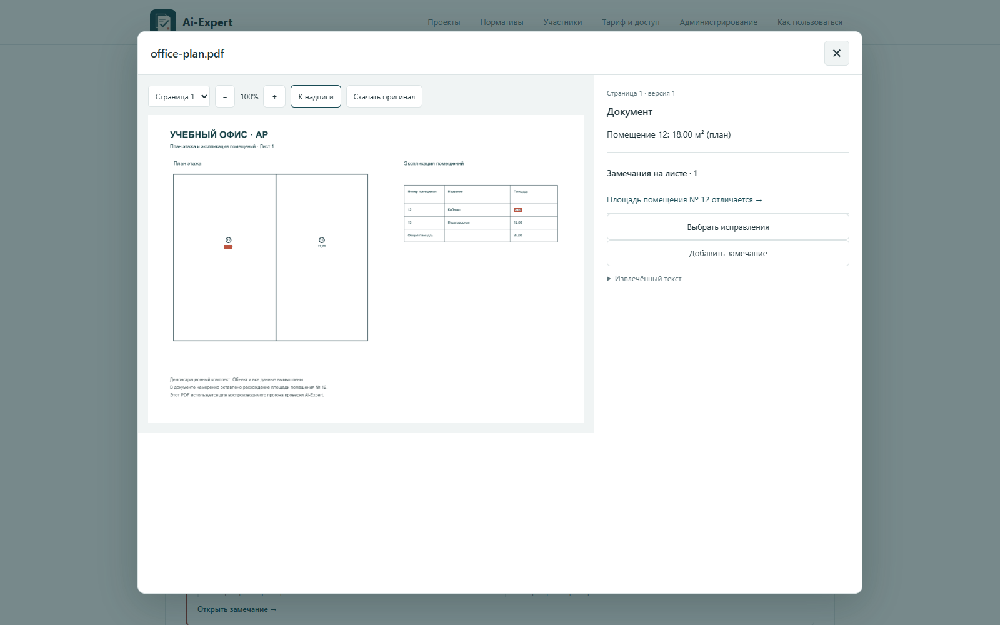
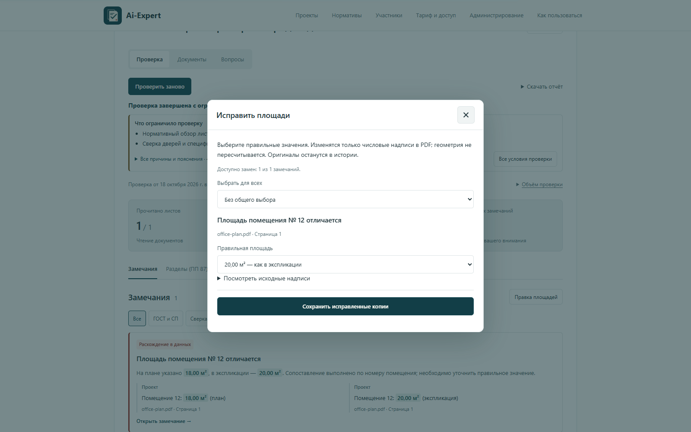
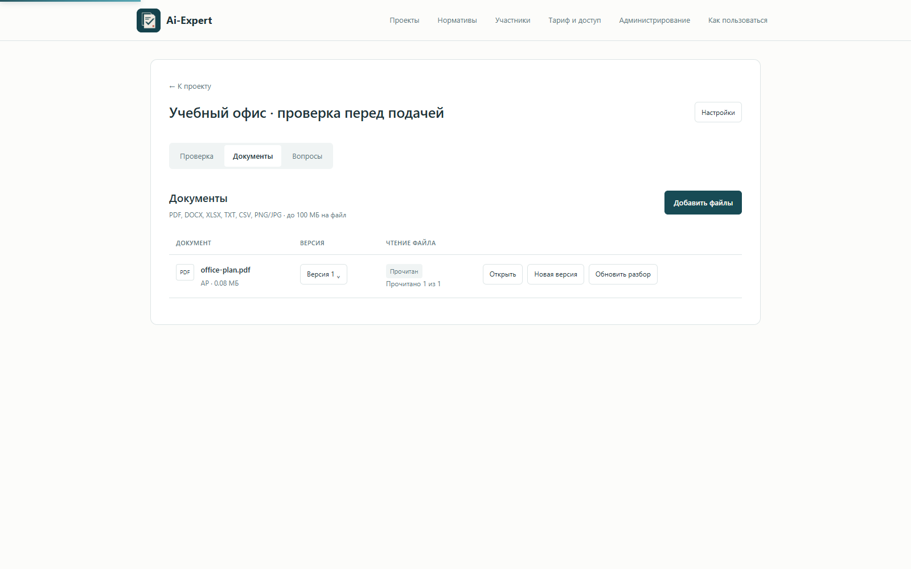
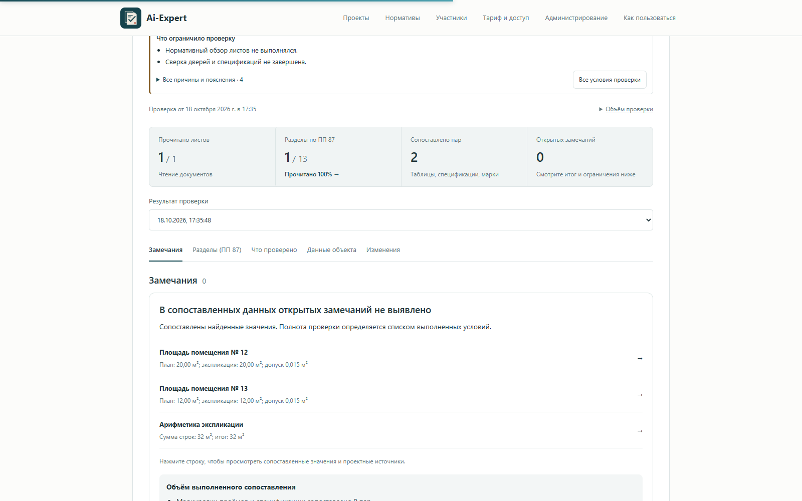
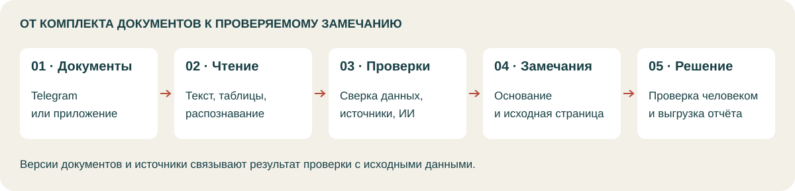

<h1 align="center">Ai-Expert · Эксперт ПД</h1>

Проверка проектной документации перед подачей.

  <a href="https://t.me/aiexpertproject_bot">Открыть бота</a> ·
  <a href="#как-попробовать">Как попробовать</a> ·
  <a href="#пример-проверки">Пример проверки</a> ·
  <a href="docs/architecture.md">Устройство проекта</a>

---

Ai-Expert проверяет проектную документацию перед подачей: ищет несостыковки между разделами, ошибки в данных и возможные нарушения требований ГОСТ и СП.

В бота загружается комплект документов. После проверки он выдаёт список замечаний: что не сходится, где это находится и на чём основан вывод. По замечанию можно открыть нужный лист, разобраться с ошибкой и исправить документы до отправки.

## Как попробовать

1. Откройте [@aiexpertproject_bot](https://t.me/aiexpertproject_bot) и загрузите документы проекта.
2. Добавьте остальные файлы в тот же комплект и нажмите **«Комплект готов — проверить»**.
3. Откройте **«Все замечания»**. Из приложения можно перейти к страницам, на которых найдена проблема.
4. Посмотрите **«Что проверено»** и скачайте отчёт в PDF или Excel.

Условия демо и лимиты — в боте.

## Что проверяет

- **Данные на чертежах и в таблицах.** Например, совпадает ли площадь помещения на плане с экспликацией и сходится ли итог с суммой строк.
- **Сведения в разных документах.** Проверки сопоставляют данные комплектов, в том числе чертежей и спецификаций.
- **Требования ГОСТ и СП РФ.** Для нормативных замечаний указывается использованный источник.

Кроме автоматических проверок, можно задать вопрос по документам, добавить своё замечание и вести общий список исправлений. В проекте сохраняются версии файлов и результаты повторных проверок.

## Пример проверки

В приложение загружен [PDF с планом и экспликацией](examples/live-demo/office-plan.pdf). У помещения № 12 на плане указано **18,00 м²**, в таблице — **20,00 м²**. Проверка нашла это расхождение и приложила обе надписи.

После выбора значения из экспликации приложение сохранило [исправленный PDF](examples/live-demo/office-plan-corrected.pdf) и проверило его повторно. Это расхождение больше не обнаружено; исходный файл остался в истории.

<table>
  <tr>
    <td width="50%"><strong>Исходный лист и найденные надписи</strong></td>
    <td width="50%"><strong>Выбор значения для исправления</strong></td>
  </tr>
  <tr>
    <td width="50%"><strong>Документ загружен и прочитан</strong></td>
    <td width="50%"><strong>Результат повторной сверки</strong></td>
  </tr>
</table>

Это снимки работающего приложения на вымышленном офисном плане. В этом прогоне выполнены числовые проверки площадей и итогов таблицы.

[Все экраны и последовательность действий](docs/demo.md) · [PDF-отчёт](examples/live-demo/check-report.pdf) · [Excel-отчёт](examples/live-demo/check-report.xlsx) · [Результаты прогона](examples/live-demo/run-result.json)

## Как это устроено

Сервер читает текст и таблицы, распознаёт сканы и запускает проверки. Числа сверяются отдельными правилами; для разбора текста и изображений используются ИИ-модели.

У замечания сохраняются документ, версия и страница. Это нужно, чтобы после загрузки нового файла старый результат всё ещё можно было проверить по его источнику.

Бот и веб-приложение работают с одним проектом. В Telegram можно отправить файлы и получить результат; в приложении — открыть документы и разобрать замечания. [Подробнее об устройстве](docs/architecture.md).

## Технологии

| Часть | Технологии |
| --- | --- |
| Сервер | Python, FastAPI, Uvicorn |
| Telegram | aiogram, Telegram Mini App |
| Веб-интерфейс | JavaScript, HTML, CSS |
| Хранение данных | SQLite, файлы документов и их версии |
| PDF и изображения | pdfplumber, pypdf, pypdfium2, Pillow |
| Распознавание сканов | RapidOCR, ONNX Runtime |
| Документы и отчёты | python-docx, openpyxl, ReportLab |
| ИИ-анализ | Текстовые и визуальные модели; провайдер задаётся в настройках сервера |

## Доступ к сервису

Ai-Expert работает в [Telegram](https://t.me/aiexpertproject_bot) и веб-приложении, которое открывается из бота. Можно загрузить комплект, запустить проверку и получить отчёт.

В результатах доступны замечания, ссылки на исходные листы и сводка выполненных проверок. После исправления документов комплект можно проверить повторно.

---

[Telegram](https://t.me/aiexpertproject_bot) · [Устройство проекта](docs/architecture.md) · [Пример проверки](docs/example-review.md)
