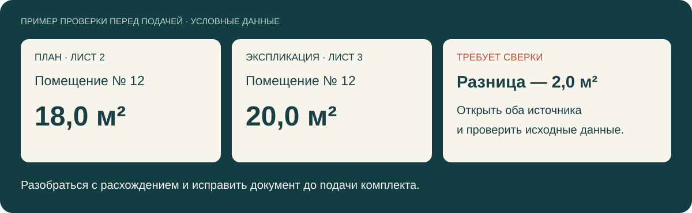

<h1 align="center">Ai-Expert · Эксперт ПД</h1>

<strong>Проверка проектной документации с замечаниями и ссылками на источники.</strong>

Загрузите комплект. Найдите расхождения. Посмотрите, откуда взялось каждое замечание.

  <a href="https://t.me/aiexpertproject_bot">Открыть бота</a> ·
  <a href="#быстрый-старт">Быстрый старт</a> ·
  <a href="#пример-проверки">Пример проверки</a> ·
  <a href="docs/architecture.md">Устройство проекта</a>

---

В проектном комплекте одни и те же сведения встречаются на чертежах, в таблицах и спецификациях. При изменениях они могут разойтись: площадь помещения исправили на плане, а в экспликации осталось старое значение.

Я разрабатываю Ai-Expert, чтобы такие места было проще находить и проверять. Сервис читает документы, сопоставляет данные и собирает замечания. У каждого замечания есть источник, к которому можно вернуться. С результатом можно работать в Telegram или в приложении проекта, а затем выгрузить отчёт.

## Быстрый старт

1. Откройте [@aiexpertproject_bot](https://t.me/aiexpertproject_bot) и создайте проект.
2. Отправьте документы. Добавьте остальные файлы к тому же комплекту.
3. Нажмите **«Комплект готов — проверить»**.
4. Откройте **«Все замечания»** и **«Что проверено»**: там доступны результаты, источники и ограничения проверки.
5. Перейдите к исходной странице в приложении или скачайте PDF- либо Excel-отчёт.

Вопрос по загруженным документам можно задать прямо в чате. Актуальные условия демо и лимиты указаны в боте.

## Пример проверки

На плане площадь помещения — **18,0 м²**, а в экспликации — **20,0 м²**. Система показывает расхождение и оба источника. Специалист выясняет, какое значение верно.

Это условный пример для объяснения процесса, а не скриншот интерфейса или результат проверки реального объекта. [Исходные данные и разбор](docs/example-review.md).

## Что умеет Ai-Expert

| Возможность | Как с ней работать |
| --- | --- |
| Комплекты документов | Добавлять несколько файлов к проекту и хранить их версии |
| Сверка данных | Искать поддерживаемые расхождения между чертежами, таблицами и спецификациями |
| Замечания с источниками | Смотреть страницу, фрагмент и основание замечания; переходить к документу |
| ГОСТ и СП РФ | Получать замечания со ссылками на использованные нормативные источники |
| Вопросы по документам | Уточнять сведения в чате и возвращаться к использованным источникам |
| Работа с результатом | Вести реестр замечаний, менять статусы и добавлять ручные замечания |
| Отчёты | Выгружать результаты в PDF и XLSX |
| Работа команды | Разделять доступ к проектам по ролям |

Наличие функции не означает, что она применима к любому документу. Состав выполненных проверок и пропуски показываются отдельно.

## Как это устроено

Сначала система извлекает текст, таблицы и доступные сведения со страниц. Для сканов используется распознавание. Затем выполняются поддерживаемые числовые и междокументные проверки, поиск нормативных источников и ИИ-анализ.

Результат связан с версией документа: замечание должно вести к тем данным, по которым оно было получено. После повторной проверки можно сравнить результаты и продолжить работу с реестром.

Подробнее: [архитектура и основные решения](docs/architecture.md).

## Технологии

| Часть | Технологии |
| --- | --- |
| Сервер | Python, FastAPI, Uvicorn |
| Telegram | aiogram, Telegram Mini App |
| Веб-интерфейс | JavaScript, HTML, CSS |
| Хранение данных | SQLite, файлы документов и их версии |
| PDF и изображения | pdfplumber, pypdf, pypdfium2, Pillow |
| Распознавание сканов | RapidOCR, ONNX Runtime |
| Документы и отчёты | python-docx, openpyxl, ReportLab |
| ИИ-анализ | Текстовые модели и модели для анализа страниц; маршрут зависит от настроек сервера |

## Что важно знать о результате

Ai-Expert находится в разработке. Он помогает при предварительной проверке документов, а итоговые решения принимает специалист.

- Распознанный текст и вывод модели могут содержать ошибки. Замечания нужно сверять с оригиналом.
- Объём проверки зависит от формата и качества файлов, доступных источников и настроек обработки.
- Автоматическая замена доступна только для поддерживаемых числовых надписей площадей в текстовых PDF. Геометрию чертежа система не пересчитывает.
- При работе с внешней ИИ-моделью выбранные фрагменты или изображения страниц передаются её провайдеру.

## Частые вопросы

**Можно попробовать без установки?**
Да, через [Telegram-бота](https://t.me/aiexpertproject_bot).

**Можно скачать и запустить приложение из этого репозитория?**
Здесь размещены описание устройства и демонстрационные материалы. Исходный код приложения хранится отдельно и не опубликован.

**Пример выше взят из рабочего проекта?**
Нет. Данные вымышлены, чтобы показать принцип сверки без пользовательских документов.

**Где посмотреть больше технических подробностей?**
В [описании архитектуры](docs/architecture.md). Для самостоятельного разбора есть [демонстрационные данные](examples/area-comparison.csv) и [пример представления замечания](examples/finding.json).

---

Проект Ильи Байлова · [GitHub](https://github.com/ilya-baylov) · [Открыть Ai-Expert](https://t.me/aiexpertproject_bot)
