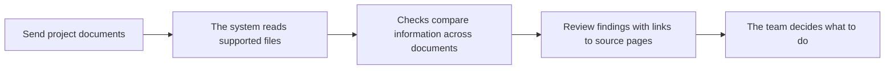

# PSD Bot

A practical workspace for reviewing project documentation.

PSD Bot helps a team compare information across project files, trace findings back to their source pages, and review results before making changes.

[Open the Telegram bot](https://t.me/aiexpertproject_bot)

## How it works

The tool is designed to make document review easier to inspect: findings include their source, and a person remains responsible for reviewing them and deciding on next steps.

## What this page shows

This repository is a public project overview. It explains the product and its workflow without publishing the full application source, working database, credentials, or user documents. Public files on GitHub can be downloaded, so only material intended for public viewing belongs here.

The application is actively developed in a separate working copy. Git version history can preserve each saved change and restore an earlier version when needed.
# PSD Bot

AI-assisted review of project documentation, available through Telegram.

Инструмент помогает предварительно проверять проектную документацию: сопоставляет сведения из разных файлов и связывает замечания с исходными страницами.

[Открыть бота в Telegram](https://t.me/aiexpertproject_bot)

Этот репозиторий — публичная страница проекта. Исходный код, рабочая база и пользовательские документы сюда не включены.
