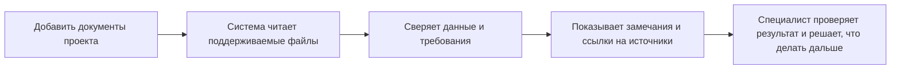

# Ai-Expert · Эксперт ПД

Рабочее пространство для проверки проектной документации.

Ai-Expert помогает сверять сведения между документами, находить возможные расхождения и смотреть, на каких страницах основаны замечания. Результаты доступны в Telegram и приложении проекта.

[Открыть бота в Telegram](https://t.me/aiexpertproject_bot)

## Как это работает

Проверка помогает быстрее ориентироваться в комплекте документов. Замечания можно проследить до источников, а итоговое решение остаётся за специалистом.

## О проекте

Это публичная страница продукта: здесь показаны его назначение и рабочий процесс, но нет полного исходного кода, рабочей базы, ключей доступа и пользовательских документов. Любой опубликованный на GitHub файл можно скачать, поэтому сюда попадают только материалы, которыми можно делиться.

Изменения самого приложения можно хранить в отдельном приватном GitHub-репозитории. История коммитов сохранит версии, к которым можно вернуться.
