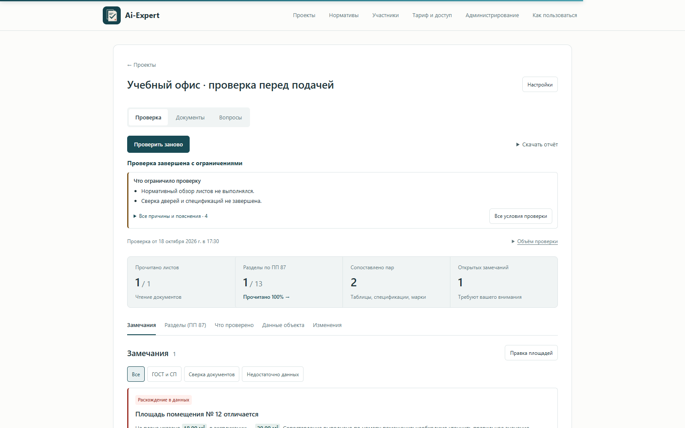
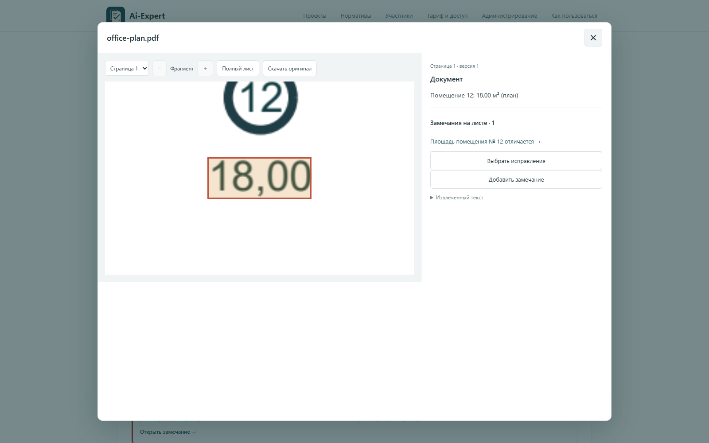
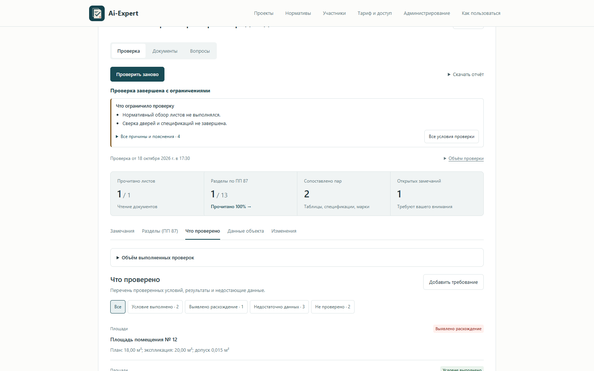
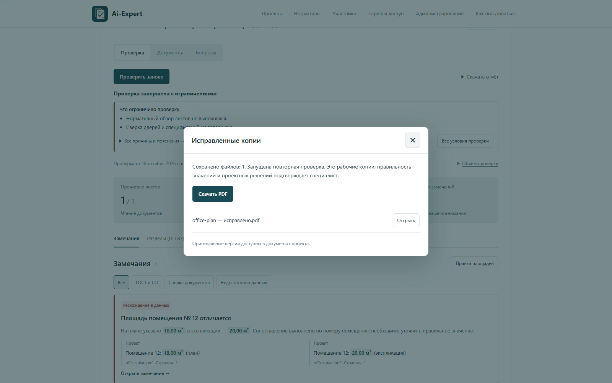
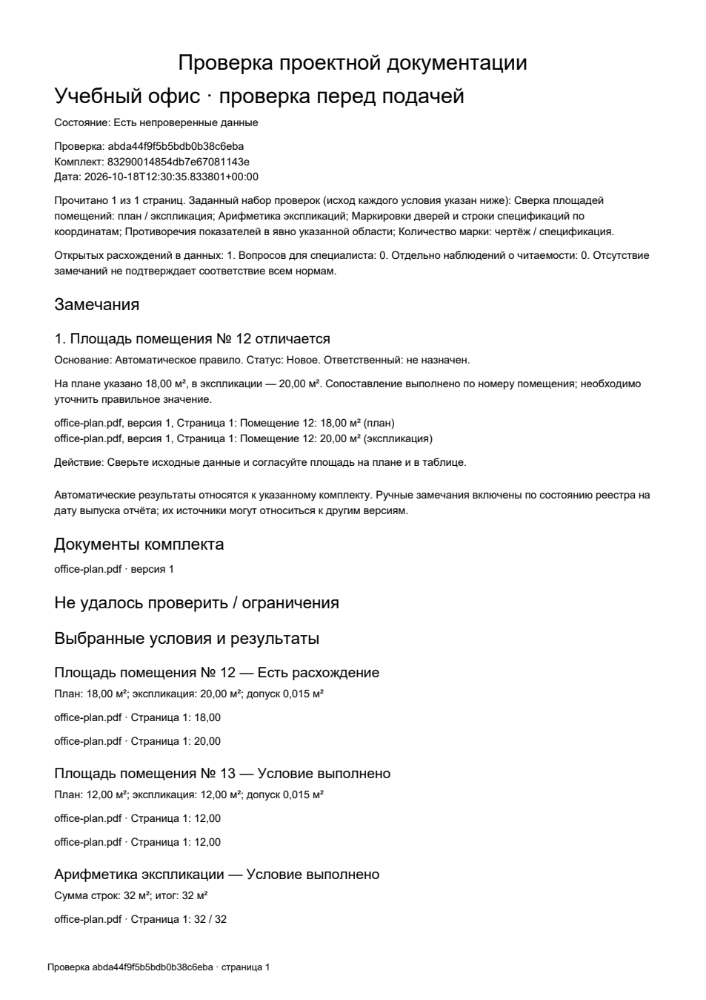

# Проверка PDF: от загрузки до исправленного файла

[README](../README.md) · [Исходный PDF](../examples/live-demo/office-plan.pdf) · [Исправленный PDF](../examples/live-demo/office-plan-corrected.pdf)

Ниже — один прогон Ai-Expert на демонстрационном офисном плане. Документ и объект вымышлены; чтение PDF, поиск расхождения, исправление файла и отчёты выполнены приложением. Модули обработки и веб-интерфейс не менялись ради съёмки.

## 1. Загруженный документ

В PDF два помещения и экспликация. У помещения № 12 площадь на плане — 18,00 м², в таблице — 20,00 м². У помещения № 13 в обоих местах указано 12,00 м². Итог экспликации — 32,00 м².

## 2. Завершённая проверка

Приложение прочитало один лист и сопоставило две пары площадей. Найдено одно расхождение.

В этом прогоне использовались числовые проверки. Нормативный и визуальный анализ внешними моделями не запускался, что отражено в сводке приложения.

## 3. Замечание и его источники

В карточке показаны оба значения, имя PDF, страница и рекомендуемое действие.

## 4. Переход к исходному листу

Из замечания открывается PDF. Надписи, к которым относится расхождение, отмечены на листе. Можно переключаться между полным листом и увеличенным фрагментом.

## 5. Выполненные проверки

У каждого условия есть результат. Совпавшая площадь помещения № 13 и верная сумма строк остаются видны вместе с найденным расхождением.

## 6. Исправление

В этом примере выбрано 20,00 м² — значение из экспликации. Приложение меняет надпись в PDF и сохраняет отдельную версию.

## 7. Повторная сверка

После исправления приложение снова проверило документ. Площади обоих помещений совпали с экспликацией, сумма строк совпала с итогом. Открытых замечаний по этим проверкам — ноль.

Оригинал после исправления был скачан повторно и побайтово сравнен с загруженным файлом: он не изменился. В исправленной копии надпись 18,00 заменена на 20,00.

## 8. Отчёт

Это страница PDF, сформированного приложением до исправления.

## Скачать файлы

| Файл | Содержимое |
| --- | --- |
| [office-plan.pdf](../examples/live-demo/office-plan.pdf) | Загруженный документ с расхождением |
| [office-plan-corrected.pdf](../examples/live-demo/office-plan-corrected.pdf) | Копия, исправленная приложением |
| [check-report.pdf](../examples/live-demo/check-report.pdf) | Отчёт до исправления |
| [check-report.xlsx](../examples/live-demo/check-report.xlsx) | Тот же результат в Excel |
| [check-report-after.pdf](../examples/live-demo/check-report-after.pdf) | Отчёт после повторной проверки |
| [run-result.json](../examples/live-demo/run-result.json) | Идентификаторы проверок, замечание, результат исправления и SHA-256 файлов |
