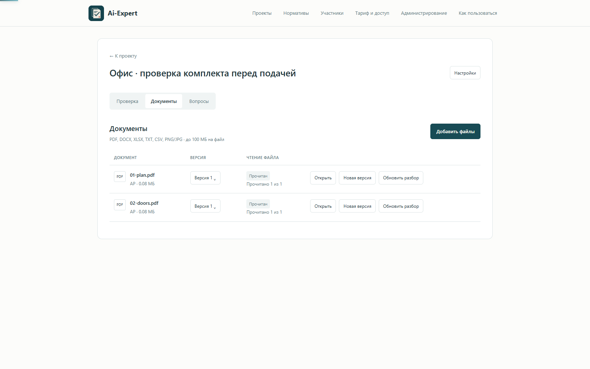
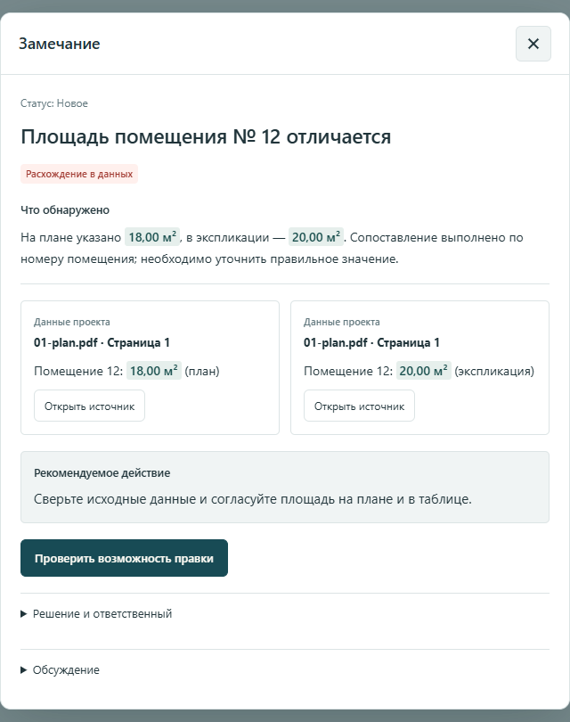
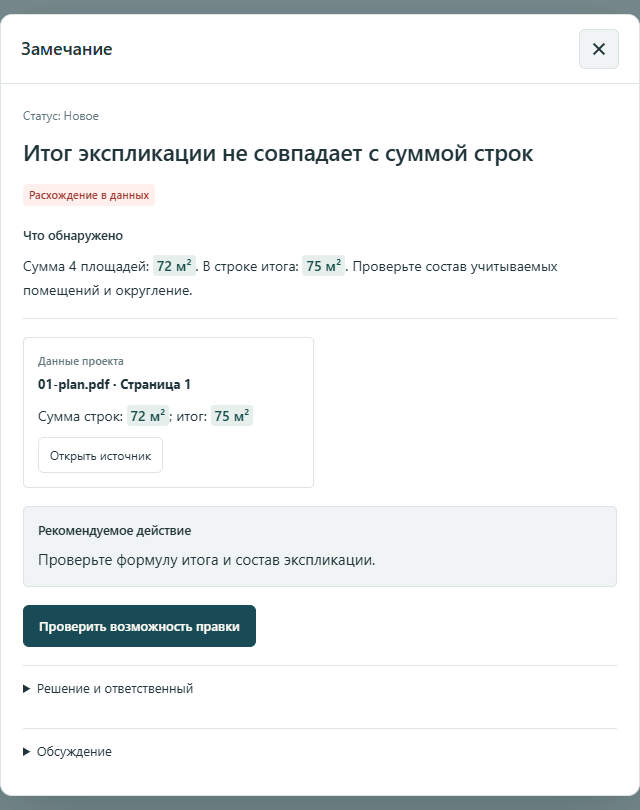
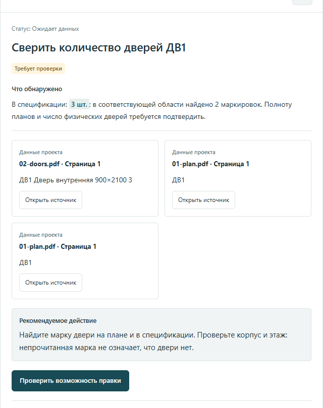
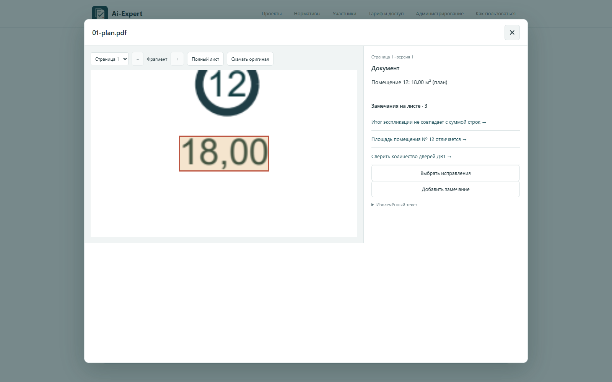
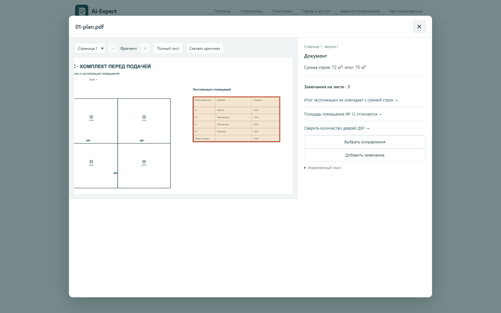
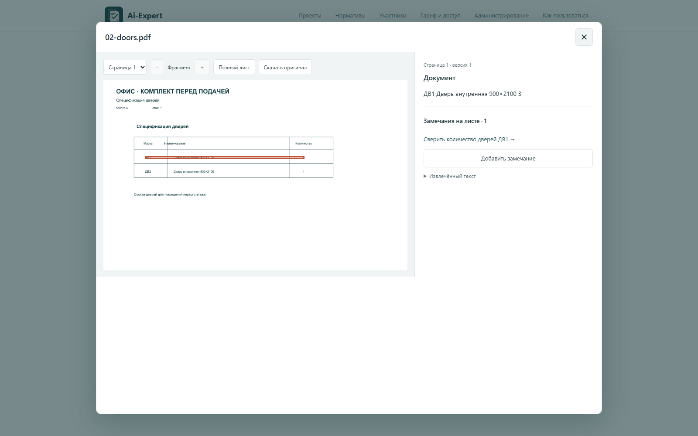
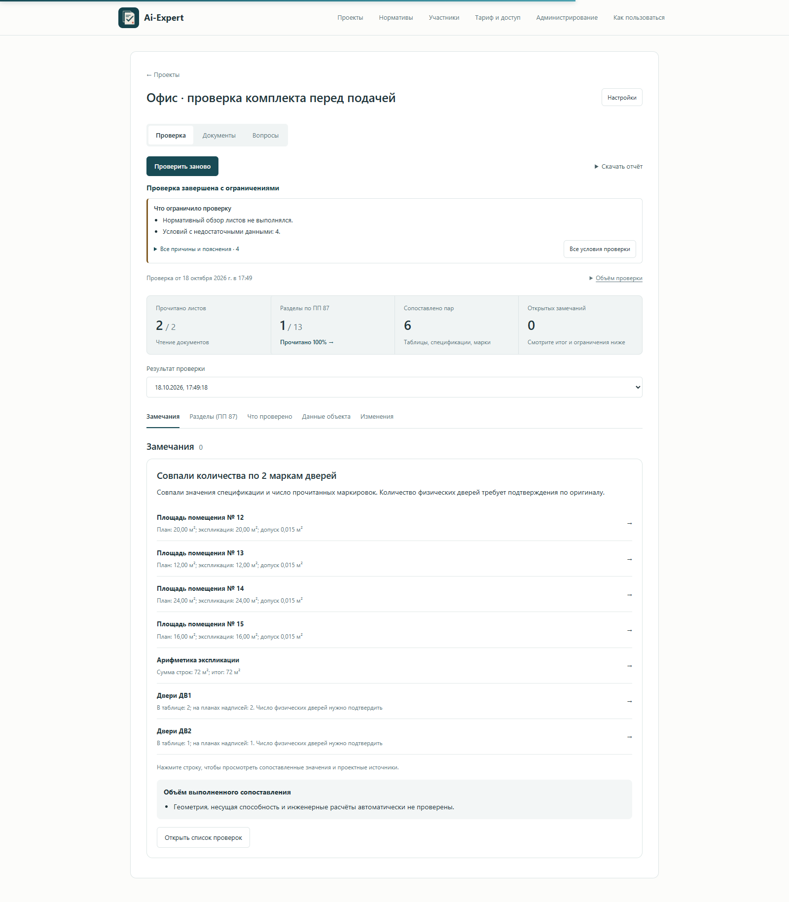
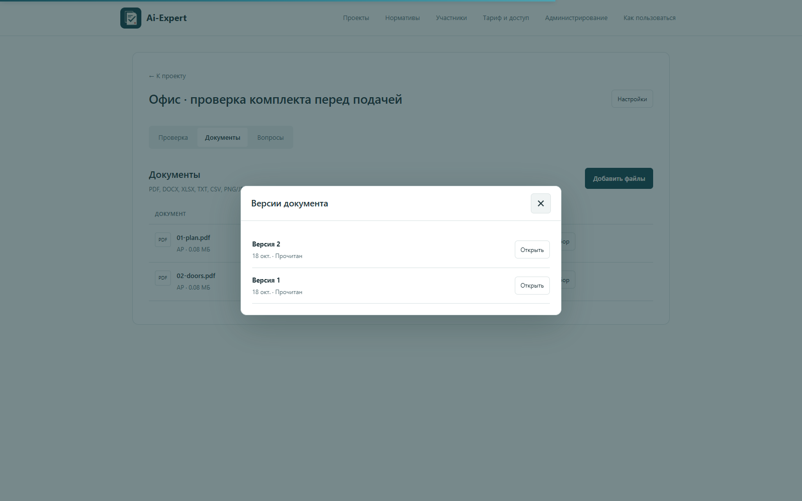
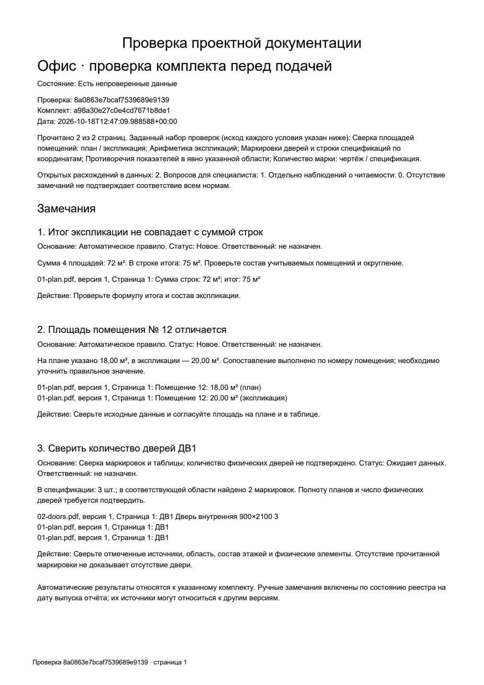

# Проверка комплекта перед подачей

[На главную](../README.md) · [Исходные документы](../examples/submission-check/initial) · [Исправленная редакция](../examples/submission-check/revised)

На примере небольшого офиса покажем, что получает проектировщик после проверки. В комплекте два листа: план с экспликацией четырёх помещений и спецификация дверей. Объект вымышленный; результаты ниже получены работающим приложением.

## Загрузить документы одного объекта

План и спецификация добавлены в один проект. Сервис прочитал оба листа и сопоставил данные.

## Разобрать найденные расхождения

### Площадь помещения отличается

У помещения № 12 на плане указано **18 м²**, в экспликации — **20 м²**. В замечании видны оба значения и ссылки на источники. Нужно определить правильную площадь и согласовать надписи в документах.

### Итог таблицы не сходится

Четыре строки экспликации дают **72 м²**, а в итоге указано **75 м²**. Замечание показывает расчёт и место в таблице, которое нужно проверить.

### Спецификация расходится с маркировками на плане

В спецификации для **ДВ1** записано **3 шт.**, на плане прочитаны **две маркировки ДВ1**. Сервис предлагает сверить документы: количество прочитанных надписей само по себе не подтверждает число физических дверей.

## Открыть место в оригинале

Из замечания можно перейти к исходному листу и нужной надписи. Так проще проверить вывод и понять, какой документ исправлять.

## Загрузить новую редакцию и проверить снова

В исходных документах исправлены площадь на плане, итог экспликации и количество ДВ1 в спецификации. Исправленные PDF загружены как новые версии; затем запущена повторная проверка.

Три показанных расхождения больше не обнаружены. В разделе «Что проверено» видны совпавшие площади, верная сумма и результаты сверки маркировок.

Оригиналы сохранились: у каждого документа доступны обе версии.

## Передать замечания команде

Результат можно скачать в [PDF](../examples/submission-check/check-report.pdf) или [Excel](../examples/submission-check/check-report.xlsx). В отчёте сохранены замечания, объяснения и источники.

## Файлы этого прогона

- [План и экспликация до исправлений](../examples/submission-check/initial/01-plan.pdf), [спецификация до исправлений](../examples/submission-check/initial/02-doors.pdf).
- [Исправленный план](../examples/submission-check/revised/01-plan.pdf), [исправленная спецификация](../examples/submission-check/revised/02-doors.pdf).
- [Отчёт после повторной проверки](../examples/submission-check/check-report-after.pdf).
- [Результаты и контрольные суммы файлов](../examples/submission-check/run-result.json).
- [Отдельный пример автоматической правки числовой надписи в PDF](demo.md).

Здесь показана числовая сверка документов. Нормативный и визуальный анализ внешними моделями в этом прогоне не запускался. Исправленная редакция подготовлена отдельно и загружена в приложение; автоматическая правка всех трёх замечаний не выполнялась.
